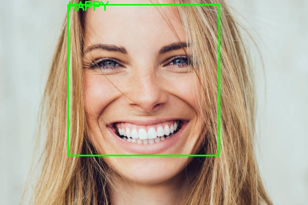

# Facial Expression Recognition

## 1. Description

The Facial Expression Recognition System is a machine learning project that detects faces in images and classifies their expressions into four categories: Happy, Sad, Angry, and Neutral.

**Project Workflow:**

Data Collection → Data Processing → Model Training → Model Testing → Result Analysis

## 2. Methodology

1. **Data Collection:** Collect labeled facial images from the dataset.
2. **Data Processing:** Convert images to grayscale, resize them to 48 × 48 pixels, and normalize pixel values.
3. **Model Training:** Train a Stochastic Gradient Descent (SGD) classifier using the selected expression categories.
4. **Model Testing:** Evaluate the trained model using a separate test dataset.
5. **Result Analysis:** Calculate the model's test accuracy and predict expressions in new images.

## 3. Input / Output

### Input

A facial image containing a detectable face is provided to the system.

### Output

The system detects the face, predicts its expression, and displays the predicted label with a bounding box. The processed image is saved as `prediction_result.jpg`.

**Test Accuracy:** 36.24%

## 4. Link

**GitHub Repository:** Add your GitHub repository URL here.